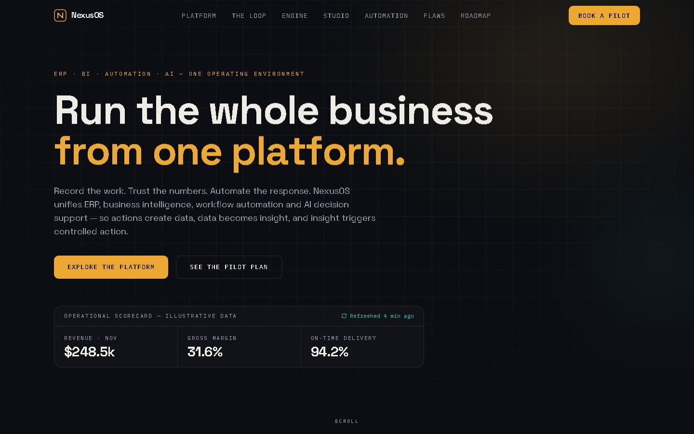
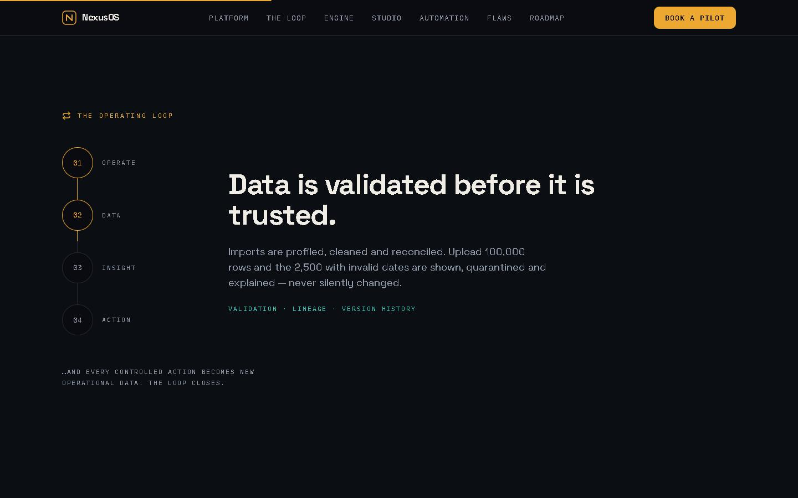
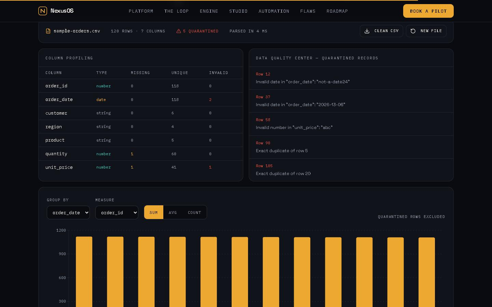

<div align="center">

# 🧭 NexusOS

**Run the whole business from one platform.**

A scroll-driven product site for a unified business operating platform —
ERP · Business Intelligence · Workflow Automation · AI decision support —
featuring **fully working in-browser demos**: a universal Data Studio
(CSV · Excel · JSON · TSV, any domain), an operations core and a live dashboard.

[](https://saloni-1919.github.io/nexusos/)
[](https://react.dev)
[](https://www.typescriptlang.org)
[](https://vite.dev)
[](https://gsap.com)
[](https://lenis.darkroom.engineering)
[](LICENSE)

</div>

---

## 📑 Table of contents

- [Live demo](#-live-demo)
- [What's inside](#-whats-inside)
- [The Data Studio — try it](#-the-data-studio--try-it)
- [Operations & dashboard — the closed loop](#️-operations--dashboard--the-closed-loop)
- [Quick start](#-quick-start)
- [How the scroll engine works](#-how-the-scroll-engine-works)
- [Project structure](#-project-structure)
- [Design principles](#-design-principles)
- [Tech stack](#-tech-stack)
- [License](#-license)

## 🚀 Live demo

**👉 [saloni-1919.github.io/nexusos](https://saloni-1919.github.io/nexusos/)**

Scroll it. Every section is choreographed — and the **Studio** section in the nav is a real tool, not a mockup.



## ✨ What's inside

| Section | What it does |
| --- | --- |
| **Hero** | Split-text character reveal, live scorecard strip with count-up KPIs, infinite module marquee |
| **The Platform** | Six spotlight cards with cursor-tracking radial highlights |
| **The Operating Loop** | A **pinned, scroll-scrubbed** sequence: Operate → Data → Insight → Action, with a progress spine |
| **Analytics Engine** | Four analytics levels + a semantic-layer metric registry |
| **KPI Scorecard** | Count-up KPIs, animated SVG revenue chart, and ⓘ popovers exposing each metric's formula, owner, source and refresh cadence |
| **Data Studio** | Universal data intake — CSV, Excel, JSON, TSV from any domain — with profiling, quarantine and charting |
| **Operations** | Working procurement loop: create → approve → receive POs, inventory updates in the same transaction |
| **Dashboard** | Live charts from your transactions, threshold alerts, one-click auto-reorder, management report export |
| **Automation** | Workflow timeline whose spine draws itself as you scroll |
| **Flaws** | Accordion of the five classic ERP/BI failure modes and their mitigations |
| **Roadmap & Assessment** | Phase plan with exit criteria; animated score bars |
| **Pilot CTA** | Validating intake form with success state |

<details>
<summary><b>🎞️ The pinned Operating Loop in action — click to expand</b></summary>
<br>



The section pins to the viewport for ~2600px of scroll; a GSAP timeline crossfades
the four stages and fills the spine in proportion to scroll position. On mobile or
with reduced motion, it degrades to a static, fully readable card stack.
</details>

## 🧪 The Data Studio — try it

The site's centerpiece demo: a real slice of the platform's data-preparation module,
running **100% client-side**. No upload, no server — your file never leaves the tab.



1. Open the [live demo](https://saloni-1919.github.io/nexusos/) → **Studio** in the nav
2. Drop **any tabular file** — `.csv` · `.xlsx` / `.xls` · `.json` · `.tsv` / `.txt` —
   or pick a sample dataset: **Sales** (CSV), **People/HR** (JSON) or **Marketing** (CSV),
   each with deliberate defects
3. Get instant **column profiling**: type detection, missing / unique / invalid counts
4. See the **data quality center**: quarantined rows with exact reasons — never silently changed
5. Build a chart: **group by** any column, pick a **measure**, switch **sum / avg / count**
6. Export a **cleaned CSV** with quarantined rows removed

The profiler is domain-agnostic: it works on whatever columns your file brings —
sales orders, employee rosters, campaign stats, sensor logs.

## ⚙️ Operations & dashboard — the closed loop

Two more live demos share one persistent state (localStorage — reset anytime):

1. **Operations**: create a purchase order → approve it → receive it. Inventory and
   KPIs update in the same motion; every step lands in the audit feed
2. **Dashboard**: charts render from *your* transactions. When stock drops below its
   reorder point a **threshold alert** fires — acknowledge it, or click
   **Auto-reorder** and the alert turns into an approval-gated PO for the exact
   shortfall with the product's preferred supplier (duplicates are blocked)
3. **Export report**: a dated management snapshot (KPIs, inventory position, open POs,
   active alerts, audit trail) downloads as Markdown

## ⚡ Quick start

```bash
git clone https://github.com/saloni-1919/nexusos.git
cd nexusos
npm install
npm run dev       # dev server with HMR
```

```bash
npm run build     # production build → dist/
npm run preview   # serve the production build locally
```

Requires Node.js 18+.

## 🛠️ How the scroll engine works

<details>
<summary><b>Lenis + GSAP, sharing one clock — click for the details</b></summary>
<br>

```ts
const lenis = new Lenis({ lerp: 0.11, smoothWheel: true })
lenis.on('scroll', ScrollTrigger.update)
gsap.ticker.add((time) => lenis.raf(time * 1000))
gsap.ticker.lagSmoothing(0)
```

- **Lenis** smooths wheel input and owns the scroll position — all anchor
  navigation routes through `lenis.scrollTo()`
- **ScrollTrigger** is notified on every Lenis frame, so scrubbed animations track
  the smoothed position with zero lag or drift
- Every effect is created inside `gsap.context()` and reverted on unmount, so
  React StrictMode double-mounting can't duplicate triggers
- Animations only touch `transform` / `opacity` — everything stays on the compositor

</details>

<details>
<summary><b>♿ Reduced-motion contract — click for the details</b></summary>
<br>

Content is **never gated on animation**. If `prefers-reduced-motion: reduce` is set:

- Lenis smoothing is skipped entirely
- SplitText / CountUp / Reveal render their final state instantly
- The pinned Loop renders as a static card stack instead of absolute-positioned panels
- Marquee, glow and scroll-hint CSS animations are disabled via media query

</details>

## 📁 Project structure

```
src/
├── data/content.ts          # all copy & data — edit here to change content
├── lib/
│   ├── gsapSetup.ts         # GSAP + ScrollTrigger registration
│   ├── scroll.ts            # Lenis singleton + smooth anchor scrolling
│   ├── dataProfile.ts       # universal intake: CSV/TSV/JSON/Excel → profiling, validation, quarantine
│   ├── ops.ts               # operations state machine: POs, inventory, alerts, auto-reorder
│   ├── opsStore.tsx         # shared ops state (context + localStorage)
│   └── report.ts            # management report (Markdown) generator
├── hooks/
│   ├── useLenis.ts          # smooth-scroll lifecycle
│   └── useReducedMotion.ts
├── components/
│   ├── reactbits/           # SplitText · CountUp · SpotlightCard · Marquee
│   ├── Reveal.tsx           # generic scroll-in reveal
│   └── ui/                  # shadcn/ui components
├── sections/                # one file per page section
│   ├── Nav.tsx      Hero.tsx       Pillars.tsx   Loop.tsx
│   ├── Engine.tsx   Scorecard.tsx  DataStudio.tsx
│   ├── Operations.tsx  Dashboard.tsx
│   ├── Automation.tsx  Flaws.tsx   Roadmap.tsx
│   └── Assessment.tsx  Pilot.tsx   Footer.tsx
└── pages/Home.tsx           # section composition
```

## 🎨 Design principles

- **Governance as content** — every KPI card carries its semantic-layer definition; quarantined CSV rows are explained, never silently modified
- **Transform-only motion** — no layout thrash; UI transitions stay under 300 ms
- **Responsive by default** — verified at 375 / 768 / 1024 / 1440 px with zero console errors and zero horizontal scroll
- **No dead controls** — every button, link, accordion, popover and form does something real

## 🧰 Tech stack

| Layer | Choice |
| --- | --- |
| Framework | React 19 · TypeScript · Vite |
| Styling | Tailwind CSS · shadcn/ui (Radix primitives) |
| Scroll | Lenis |
| Animation | GSAP + ScrollTrigger |
| Charts | Recharts · custom SVG |
| Data intake | Papa Parse (CSV/TSV) · SheetJS (Excel, lazy-loaded) · native JSON |
| Type | Space Grotesk · IBM Plex Mono (self-hosted via Fontsource) |
| Hosting | GitHub Pages |

## 📄 License

MIT — see [LICENSE](LICENSE). All business figures on the site are illustrative demo data.
